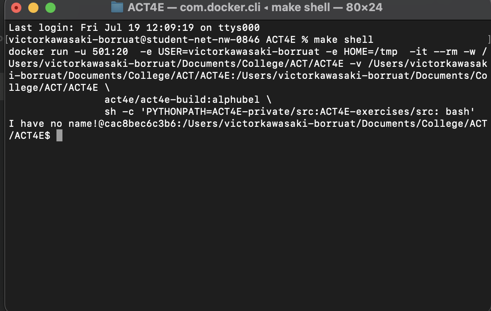

# Applied Category Theory for Engineering (ACT4E)
{width=500px}
This repository contains the sources to the book used in the Applied Category Theory for Engineering classes which are taught at ETH Zürich and online.

A recent version of the PDF book can be obtained at [this link (PDF, ca. 400 MB)][pdf].

Note for instructors: please contact us on our [website][website] to obtain a copy that also contains the solutions to all the graded exercises.

[pdf]: https://z7-stage-act4e-book.zuper.ai/sync/ACT4E/ACT4E/alphubel-prod/build/last/build-public/ACT4E-public.pdf
[website]: https://applied-compositional-thinking.engineering/

# Introduction

The following sections are a guide to help you get started with the ACT4E book. It will guide you through the installation process, explain how to interact with the book, and provide an overview of the repository structure. The document is intended for Teaching Assistants (TAs) who will be working on the book, but it can also be useful for anyone who wants to contribute to the project.

# Installing the book

Here you will learn how to interact with the book. You will need to install Docker on your work machine, which you can install by clicking [here](https://docs.docker.com/engine/install/) or visiting <https://docs.docker.com/engine/install/>. Next, open the terminal and type in

``` bash
docker pull act4e/act4e-build:alphubel
```

This should not produce any errors.

## Installing Git

You will also need `git` to work with the book.Install it from [here](https://git-scm.com/book/en/v2/Getting-Started-Installing-Git) or visit <https://git-scm.com/book/en/v2/Getting-Started-Installing-Git> & follow the instructions for your operating system.

> **Remark 1**. *Make a Github account, and make sure you are an accepted user for the ACT4E repository. You can check if you have access by visiting [this](https://github.com/ACT4E/ACT4E-solutions) page (solutions page is only available to members of the ACT4E organisation[^1]).*

### Generating Access Token

I actually have no clue how i did this, TODO.

## Cloning the Repository

### Cloning via the Terminal

Next, you will clone the repository onto your computer. This will give you access to all the files from the book, so you can actually work with it. First off, open your terminal on the **desired folder you want the book to be in**. This can be done e.g. on MacOS by right clicking on a folder, and saying "Open Terminal in Folder".

> **Remark 2**. *You **cannot** have any whitespace or funny characters in your folder name. E.g. the name "ETH Book" does **not** work, as it contains a whitespace. The best option is just to call it "ACT" or something of the likes.*

- Clone the repository by typing

```bash
git clone --depth=1000 git@github.com:ACT4E/ACT4E.git
```

  or (preferred option)

```bash
git clone https://github.com/ACT4E/ACT4E.git
```

  You should now have a folder called `ACT4E` in your initial folder. In our example, you would have the folder `ACT4E` inside the folder `ACT`. If you do not, you have not pulled from the repo. Please try again.

- Next, open navigate **with the terminal** to the folder called ACT4E (e.g. by doing the right-click thing again) or by typing in the terminal

```bash
  cd ACT4E
```

- Clone the solutions reposiotory by typing
```bash
git clone git@github.com:ACT4E/ACT4E-solutions.git
```

  or preferably

```bash
git clone https://github.com/ACT4E/ACT4E-solutions.git
```

You should now have the `CT4E-solutions` folder inside the `ACT4E` folder. It's a bit of a mess, but you should have it somewhere in there.

### Cloning via GitHub Desktop

If you prefer a graphical interface, you can use GitHub Desktop to clone the repository instead of using the terminal.

- First, download and install GitHub Desktop.

- After installing, open GitHub Desktop and sign in with your GitHub account.

- If your GitHub account is already linked to the repository, you can directly select the repository:

  - In the top-left corner, click `File`, then `Clone repository`.

  - In the `GitHub.com` tab, you should see a list of repositories you have access to. Look for `ACT4E` and select it.

  - Choose the local path where you want to save the repository. Make sure the folder name doesn't contain spaces or special characters, just like the terminal instructions above.

  - Click `Clone` to download the repository to your computer.

- Then, select the location where you want to clone the repository and click `Clone`.

You should now have the `ACT4E` folder in the location you selected.

To clone the solutions repository using GitHub Desktop:

- Follow the same steps, but this time select the `ACT4E-solutions` repository from the list of available repositories. If it's not linked to your account, you can copy the link of the repo directly into GitHub Desktop.

# Quick Tour of the Repository

## Structure of the Repository

The repository may seem quite daunting and complicated at first. And while that very well may be the case, I'll provide you here with a basic idea of the structure of the contents.

- The main LaTeX files for the book are in the `volumes/vol1` directory. Within this directory, the various categories of the book are split into different subdirectories. (I don't know why they're numbered like this or the logic behind TODO). The way they are organized is as follows: the main category of topics has various subfolders, which correspond to a book **chapter**. You will recognize whether a directory is a category or a chapter by checking if it contains the `chapter.tex` file.

- The `sag` folder contains all `.tikz` files used for all LaTex-generated diagrams in the book. Contrast this to the `pics` folder which contains regular `.png`s, e.g. for the chapter covers.

- `ACT4E-solutions` is the repository with all the exercises, solutions, exams and past homeworks. Its basically a big folder of `.tex` files, each corresponding to a solution to an exercise. There are a few subfolders here, corresponding to the homeworks of the respective semesters.

## CircleCI

CircleCI is a continuous integration and continuous delivery (CI/CD) platform that automates the process of building, testing, and deploying code. In the context of our research group's book project, CircleCI is set up to automatically run certain checks whenever you push changes to the repository.

Specifically, when you push your LaTeX code to the repository, CircleCI will:

- Automatically Trigger a Build: Every time you push changes, CircleCI will start a new build process. This process typically involves setting up the environment, installing dependencies, and then running specified tasks.

- Check if LaTeX Code Compiles: As part of the build process, CircleCI will compile your LaTeX code. This ensures that any errors in the LaTeX files are caught early before they get merged into the main branch.

- Provide Feedback: If the LaTeX code compiles successfully, the build will pass, and CircleCI will notify you accordingly. If there are errors in the LaTeX code, the build will fail, and CircleCI will provide logs and details about what went wrong, allowing you to quickly identify and fix issues.

By integrating CircleCI with our repository, we ensure that the LaTeX code for the book is always in a working state, which helps maintain the quality and consistency of the content across the team.

> **Remark 3**. *You need to make sure that your GitHub account is correctly connected to CircleCI. If you are not sure, you can check this by going to the CircleCI website and logging in with your GitHub account. You should see the ACT4E repository listed there.*

# Compiling & working with the book

To interact with the book you **must** have Docker open. Just click on the icon, and let the app open. It should say "Docker is running\" once it's done. It may take a few minutes to get started. You can now, **from the** `ACT4E` **folder**, type into the terminal

``` bash
make shell
```

This should modifiy your terminal a bit, and your terminal will look like the next figure.

> **Remark 4**. *We will use the computer science terminology of 'root folder' or just 'root' to designate where the repository has been cloned. This is the folder called `ACT4E`.* 


Expected Terminal display

## Compiling the entire book

This is not recommended, it takes over an hour, but here's the command. From the root folder, type

```bash
make ACT4E-devel-slow.pdf
```

## Compiling a Chapter

This is how you *should* be working. From the root, type the command

```bash
make -C volumes/vol1/10_arrows/10_cats/ chapter-continuous
```

and swap out the folder names to whatever chapter you are working on. If no errors are flagged, the last line of the output of the terminal should be

```bash
=== Watching for updated files. Use ctrl/C to stop . ..
````

> **Remark 5**. *There will be a lot of warnings, that's fine. It's mostly references to other chapters of the book. As long as the output is as above, you're fine.* 

> **Remark 6**. *Don't forget you need to* 
> 1.  *have Docker open and running*
> 2.  *have typed `make shell` in the root repo. Working from your basic     shell will not work.*

Now, **keep the terminal open** and just edit the book in your editor of choice, and when you will hit `Ctrl+S`, the changes will be automatically detected and the chapter will be recompiled. Obviously, you'll have to close your PDF viewer, wait for compilation to be done, and reopen once it's done to see the changes.

## Compiling the book with VS-Code

If you are using VS-Code, you can use the LaTeX Workshop extension to compile the book. To do this, open VS-Code and navigate to the root folder of the repository. Now every file is displayed in the sidebar. Click on the file you want to compile, and then click on the green arrow in the top right corner of the editor. This will compile the file and display the output in the integrated PDF viewer. (Make sure that docker is running?? I do not know if this is necessary)

## Compiling the book with TexShop

You also are able to compile the book using TeXShop on MacOS. You can dowload TeXShop from the MacTeX website. After installing TeXShop, you can selct the file you want to compile and click on the "Typeset" button in the top bar. This will compile the file and display the output in the integrated PDF viewer. (Make sure that docker is running?? I do not know if this is necessary). You need to make sure that you also have the kaobook repo cloned on your computer. You can do this by following the instructions in the "Installing the book" section. You should save the kaobook folder in the same directory as the ACT4E folder. (On the same level) Then you will be able to compile the book or individual chapters using TeXShop.

# Editing the book with Git

If you've never used Git, please watch an introductory video on how it works / what it is. Here, i'll explain how you work with the book. You should use git from **your own shell, not the one used for compilation of the book**! For that reason, I recommend simply opening two terminals, one to edit, one to use git.

## Structure of the Repository

The `ACT4E` repo has a bit of a complex structure. Here's a quick breakdown of what is where (only relevant folders for TAs).

- `volumes/vol1` contains the files for the current version of the book. The sub-folders within are not chapters, but correspond to larger sections of the book. It's the folders within such larger sections that then correspond to individual chapters (which you can compile). For example, $\texttt{vol1/30\_design/15\_poset\_bounds}$ is a chapter. You can double-check that this is the case by checking that you can also find a `chapter.tex` file inside of it.

- `sag` contains `.tikz` files and their compiled PDFs that we use for
  the book

The ACT4E-solutions repo is for the solutions to the homework exercises. Each `.tex` file is a solution we use for corrections. Please don't touch them unless asked. There are also folders containing the homework sheets/exams of past & current iterations of the course.

## Editing with Git

The way we work is with `git`. It's a version control software, allowing us to work remotely, and clump modifications together all at once. A few important things to know before you get started are

- The branch `alphubel-prod`

### Opening your branch

Your branch is like your desk. You work on it, and only you. Other people may look, but it would be rude to use it. If you don't have a branch yet, type

```bash
git checkout -b your-new-branch-name
```

and you can verify that you're on it by typing

```bash
git branch
```

The above will display the various branches you've opened on your computer. Not all the ones on the repo. The branch `alhubel-prod` is the publicly available version of the book, and `alphubel-stage` is where all the changes are sent to and merged into, before being double-checked and added to `alphubel-prod`. It's basically the 'final draft' branch. We do not work directly from this branch, but we 'pull' from it, to update our branch when needed.

### Before you start editing

Open the terminal in the root repo, and type

```bash
git pull
```

This will just check that you have the latest version of the branch you're on. You can skip this step if you're not pulling from `alphubel-stage`. Next, check that everything is okay by typing 

```bash
git status
```

This will show you if any modifications or unsaved changes are on your branch.

### After you've edited the book

Now, type in

```bash
git add . git commit -m \"your commit message\"
```

and finally, if this is your first time pushing to this branch

```bash
git push --set-upstream origin your-branch-name
```

or just

```bash
git push
```

This will 'send' everything to the repo.

> **Remark 7**. *To improve efficiency, PDF files are neither pushed nor pulled, thanks to `.gitignore` files that are set up already (you don't have to deal with them). These tell the git system to ignore files with certain file extension names, such as ".pdf\".* 

### Using GitHub Desktop for Branching and Editing

You can perform all the operations mentioned above using GitHub Desktop as well. Here's how:

#### Opening Your Branch with GitHub Desktop

- Open GitHub Desktop and make sure you're in the repository you want to work on.

- In the top menu, click on the `Current Branch` button to view all available branches.

- If you already have a branch, select it from the list. If you don't, click on `New Branch. ..` to create one.

- Enter your new branch name and click `Create Branch`.

- GitHub Desktop will automatically switch to your newly created branch, where you can make your changes.

#### Before You Start Editing with GitHub Desktop

Before making any changes, it's important to ensure you're working on the most up-to-date version of your branch:

- In GitHub Desktop, click the `Fetch origin` button in the top bar to pull any changes made to the branch you're working on.

- After fetching, click `Pull origin` to apply any changes to your local branch.

- Check the status of your repository by going to the `History` tab, where you'll see recent commits, or in the `Changes` tab, which will show any modifications you've made.

#### After You've Edited the Book with GitHub Desktop

Once you've made your changes, here's how to commit and push them:

- In the left panel, you'll see a list of modified files. Review the changes.

- Enter a summary and description of your commit (this acts as your commit message).

- Click `Commit to your-branch-name` to commit your changes locally.

- To push these changes to the remote repository, click `Push origin`.

- If this is your first time pushing this branch, GitHub Desktop will automatically handle the setup for the upstream branch, so you won't need to use the terminal command for `git push --set-upstream origin your-branch-name`.

> **Remark 8**. *Just like when using the terminal, GitHub Desktop honors the `.gitignore` file, meaning certain files (like PDFs) won't be pushed or pulled.* 

# Exercises

Generally, in the book, there are two kinds of exercises: "regular" exercises and "graded" exercises. The regular ones have solutions that are written directly in the `.tex` files of the book, while the graded exercises have solutions written in a separate `.tex` file that is in the `ACT4E-solutions` repo. The graded exercises are used both in the book, and also for homework sheets that are created each semester for the teaching at ETH.

## Compiling the Exercises

For the exercise sheets (and this document, additionally), we do not compile lie the book. Instead we use `pdflatex`.

### Installing PDFLaTeX

Open your terminal, and if you are on Mac[^2], type

```bash
brew install --cask mactex
```

and check that is has been installed by typing

```bash
pdflatex --version
```

### Compiling

This is much more straightforward. From the directory **where you wish the .pdf to be produced**, open the terminal (or navigate there) and type the following command

```bash
gpdflatex -shell-escape name-of.document.tex
```

Obviously, if you are not in the directory where your file is, insert the path to the `.tex` file.

### Compiling the Exercises with VS-Code/TeXShop

You can compile the exercises also using VS-Code or TeXShop. You can use the above instructions in the previous chapters to do it.

[^1]: *sounds cryptic, right?*

[^2]: This assumes you have `brew` installed. If you don't, then please do?
